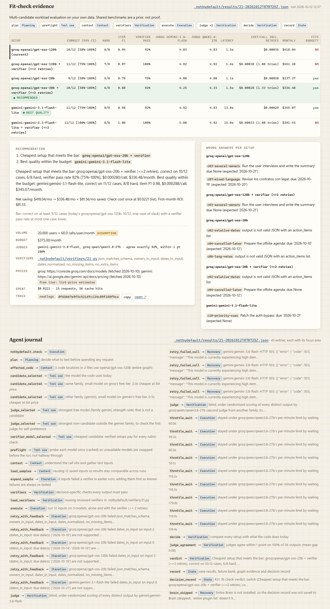

# NotByDefault

**Prove the choice. Recheck the decision.**

AI coding agents pick models, databases and SDKs on their own and give a one-line reason: "cost-effective", "widely used", "GDPR compliant". Nobody checks that reason, and nobody revisits the choice when the budget, a price or a requirement changes.

NotByDefault catches those decisions as the agent makes them, tests the stated reason against your project's own data, records the evidence next to the code, and reopens the decision when an assumption it depends on changes.

> No decision without a why.

## How it works

1. **Capture.** A Claude Code `PreToolUse` hook notices when the agent writes a model name, installs an SDK or edits a manifest. It records the decision, the agent's own words from the session transcript, and the code it affects, in a SQLite decision graph stored with the repo. The hook doesn't block the tool call: it returns an `ask` prompt that names the choice and the command to test it.
2. **Check the claims.** `claims` splits the reason into cost, quality, latency, compliance and popularity claims. It gives each one a verdict (true, false or untested) with a source. Popularity is never treated as evidence about your project.
3. **Test the choice.** `check` runs the current model and candidates from other providers on your cases. Each runs alone and with a decision-specific verifier, and is scored against reference answers. Two blind judges from different model families break ties. Every result carries a 95% interval, and the cost estimate comes from your volume and budget.
4. **Record.** Each decision gets a Markdown record (`decisions/*.md`) and a receipt in the web UI, with the evidence, rejected alternatives, assumptions and trace IDs.
5. **Revisit.** `require` and `watch` reopen decisions when a requirement or a recorded assumption changes. **`stale`** means a documented fact now breaks the decision. **`needs_review`** means it might conflict, but a human has to judge (for example, it depends on how something is deployed).
6. **Act.** `resolve` takes one decision from its verdict to a local branch: it edits only that decision's call sites and runs generated and existing tests. It never commits without asking and never pushes. If the winning setup needs code it can't generate yet (a verifier loop), it recommends the setup and stops.

## A real example: decision #21

An agent chose `openai/gpt-oss-120b` (on Groq) to extract action items from meeting notes. The demo's agent reason is a **scripted example**, labeled as such in the data: *"cost-effective, strong at structured extraction, widely used in production."*

`check 21` ran 12 hand-written cases (8 hard) through 3 models, each alone and with a verifier. Every request went live to the providers, and the run resumed across a free-tier quota reset.

| setup | correct | hard | monthly (projected) | in $375 budget |
|---|---|---|---|---|
| gpt-oss-120b (today) | 10/12 | 6/8 | $418.04 | no |
| gpt-oss-20b + verifier | 10/12 | 6/8 | $336.48 | yes, cheapest that meets the bar |
| gemini-3.1-flash-lite | 11/12 | 8/8 | $345.07 | yes, best quality (13.8 s vs 1.5 s latency) |

- **Claim check:** "cost-effective" is **false** (over budget at the assumed volume) and "strong at structured extraction" is **false** (a cheaper in-budget model scored 11/12). "Widely used" is **untested**: it's not evidence about this project.
- **Verdict:** switch. The projected saving is **$418 → $336/month (~$82/month) at the same 10/12**. Item F1 and judge scores are lower for the cheaper setup. `resolve 21` recommends the switch and stops, because adding a verifier loop to the code isn't automated yet. The saving is projected, not realized.
- **Requirement change:** after `require "data must stay in the EU"`, #21 and the older Groq decision #13 go **stale** (Groq documents US data residency). MongoDB goes **needs_review**, because where its data lives depends on deployment.
- **Evidence:** 71 live requests to 5 models, $0.0461 at list price (on free tiers, so nothing was billed). neatlogs trace `0f65667e9f5c521dfc124c89f188f9ca`. Full report in [`demo-app/decisions/0002-ai-model-openai-gpt-oss-120b.md`](demo-app/decisions/0002-ai-model-openai-gpt-oss-120b.md).

All monthly costs assume 20,000 users × 60 calls per user per month, at list prices fetched 2026-10-10. Those are demo scenario assumptions, and the figures change with them. With 12 cases, one case is 8 points, so small differences aren't meaningful. An earlier run of the same check recommended a different setup; [`docs/demo_claims_audit.md`](docs/demo_claims_audit.md) traces every number to its run.



## What's different

- **Your data, not leaderboards.** Candidates are tested on your call site's own inputs against reference answers. Shared benchmarks are a prior, not proof.
- **It checks the reason, not only the choice.** Each claim the agent made gets its own verdict and source.
- **Decisions stay open.** Budget, volume, prices, region and requirements are stored as assumptions, and a change reopens exactly the decisions that depend on them.
- **Honest uncertainty.** It reports confidence intervals, a "too close to call" outcome, and stale vs needs_review instead of a single yes/no.
- **Bounded spend.** Each check estimates its cost before making any request, enforces a `--max-cost` cap, caches every response, and resumes after a quota stop without repeating requests.

## Quickstart

Requires Python 3.12. The CLI is run as `python -m notbydefault` (there's no separate console script).

```bash
git clone https://github.com/Mischa0099/notbydefault && cd notbydefault
python -m venv .venv && source .venv/bin/activate     # Windows: .venv\Scripts\activate
pip install -e ".[ui,dev]"
python -m pytest -q                                    # 475 tests, no network
```

Create `.env` in the repo root (gitignored) with `GROQ_API_KEY=` and `GEMINI_API_KEY=`, and optionally `NEATLOGS_API_KEY=` for traces. Then, on your own project:

```bash
python -m notbydefault init path/to/app --goal "..." --users 20000 --budget 375
python -m notbydefault install path/to/app             # adds the hooks to path/to/app/.claude/settings.json
# ...work in path/to/app with Claude Code; the hook records decisions...
python -m notbydefault show path/to/app                # the decision graph
python -m notbydefault check <id> --project path/to/app --max-cost 0.15
python -m notbydefault claims <id> --project path/to/app
python -m notbydefault require path/to/app "data must stay in the EU"
python -m notbydefault ui --project path/to/app        # http://127.0.0.1:8765
```

| Command | What it does |
|---|---|
| `check <id>` | Fit-check a decision on your own cases (estimates cost first, `--max-cost` cap) |
| `claims <id>` | A verdict on each claim in the agent's reason |
| `resolve <id>` | Dry run of the switch; `--apply` edits on a local branch with tests |
| `require <dir> "<text>"` | Add a requirement; mark decisions stale or needs_review |
| `watch` | Reopen decisions whose assumptions changed |
| `why "<question>"` | Answer from recorded decisions only, with sources |
| `scan` | Decision debt: unchecked choices, false claims, expired assumptions |
| `ui` | Local web UI: decision graph, receipts, timeline, evals, costs |

The demo project's state (`demo-app/.notbydefault/`: graph, results, response caches) is gitignored. A fresh clone therefore can't replay the #21 run offline. The published evidence is the decision record and the screenshots. On the author's machine, `scripts/recording_setup.py` builds a disposable copy that replays the live run from cache with no requests (see [`docs/recording_plan.md`](docs/recording_plan.md)).

## Evaluation

Measured on our own cases with known answers (`eval/results/v1.json` to `v3.json`):

| | v1 | v3 | v3 held-out |
|---|---|---|---|
| Decision detection recall | 0.81 | 1.00 | 1.00 |
| Pivot recall | 0.67 | 1.00 | **0.50** |

The held-out cases were written before the fixes, and that's where the next version has to improve. The cases are self-written and not independently labeled. 475 tests, all offline.

## Sponsor tools

- **neatlogs:** every check, model call, verifier and judge is a span in one trace, with tokens, cost and a focus area (`notbydefault/fit/tracing.py`). Spans are sent only when `NEATLOGS_API_KEY` is set.
- **Entire:** Entire's code graph finds the code each decision affects, which is how `resolve 21` edits `actions.py` but leaves `app.py`, owned by decision #13, alone (`notbydefault/affected.py`, `entire.py`). Decision records are committed with the code, so they land in that commit's Entire checkpoint (`checkpoints.py`). Every Entire call degrades gracefully when the CLI or a feature is unavailable.
- **cfo.ai:** the pricing hypothesis ($49/team/month Starter, $149 Growth) and 12-month runway were modeled with cfo.ai's Ari agent from `business/costs.csv`, which `export-costs` generates from the graph. See [`business/plan.md`](business/plan.md). These are projections, not validated demand.

**Data flow:** model calls go to Groq and Google AI Studio (and OpenRouter if configured). Your notes, cases and code paths are sent to them as prompts. Nothing is sent to Anthropic or OpenAI by NotByDefault.

## Limitations

- Every monthly cost and saving is a projection from assumed volume and list prices. The demo ran on free tiers.
- Results come from 12 cases per decision, so verdicts can change between runs. The audit documents one that did.
- `resolve` can't yet add a verifier loop to code. When that's the winning setup, it recommends and stops.
- The demo's agent reasons and one pivot are seeded or scripted, and labeled as such in the data. The hook capture and every check are real code.
- A live check can need a resume across days when a free-tier quota runs out.
- `test_hook_is_fast` (300 ms limit) can be flaky under full-suite load.

## More

- Architecture: [`ARCHITECTURE.md`](ARCHITECTURE.md)
- Demo claims audit: [`docs/demo_claims_audit.md`](docs/demo_claims_audit.md) · Recording plan: [`docs/recording_plan.md`](docs/recording_plan.md)
- Costs export: [`business/costs.md`](business/costs.md)

## Submission

neatHack, October 10–12, 2026 · solo, [@Mischa0099](https://github.com/Mischa0099) · Repository: https://github.com/Mischa0099/notbydefault · Demo video: _VIDEO_URL_PLACEHOLDER_
